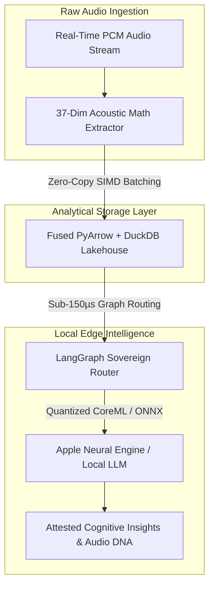

# 🔒 Sovereign Audio Intelligence

> **Local-first cognitive audio research, native inference and reproducible DSP workflows**

[](#)
[](#)
[](#)
[](https://github.com/adamscarmccoy-boop/sovereign-audio-intelligence/actions)

---

## November 12, 2026 — Sovereign Music Engine update

The project now includes a [public music-engine architecture and verification checkpoint](docs/SOVEREIGN_MUSIC_ENGINE_ARCHITECTURE_2026-11-12.md), covering distinct generation, Demucs stem separation, acoustic analysis, registry-driven execution, native DSP, and Ableton integration lanes.

**Verified:** the original Sovereign Big Brain ONNX loads and executes via ONNX Runtime with a 64-dimensional input and 12-dimensional DSP output. Separate audio generation, mastering, and stem-separation experiments have also been run.

**Still being validated:** the exact trained 64-D input binding, the stored pre/post-operation acceptance policy, live native executor routing, and full-track autonomous mastering. The model's output is not itself an accept/reject verdict.

**Scope:** this repository covers Sovereign Music Engine as a whole. Ableton Live remains a production/control integration, not the core inference engine. No private weights, full machine manifests, or audio samples were published as part of this documentation update.

---

## ⚡ Executive Summary
**Sovereign Audio Intelligence** explores local-first acoustic analysis, native model inference, and auditable audio-processing workflows. The repository contains implementations, prototypes and architecture checkpoints spanning multiple execution environments. Individual performance, privacy and native-execution claims require independent verification for each configuration.

---

## 🚀 Quickstart: How It Runs

### 1. Ingestion & 37-Dim Acoustic DNA Extraction
```python
import duckdb
import pyarrow.parquet as pq

# Connect to local embedded analytical lakehouse
con = duckdb.connect(database=':memory:')

# Query vectorized acoustic feature extractions
query = """
SELECT 
    track_id, 
    rms_energy, 
    crest_factor, 
    spectral_centroid, 
    lufs_integrated,
    harmonic_ratio
FROM 'audio_deep_dive_report.parquet'
WHERE crest_factor > 3.5
LIMIT 5;
"""
results = con.execute(query).df()
print("Vectorized Extraction Query Results:\\n", results)
```

### 2. Interactive Jupyter Notebook
```bash
# Launch the Sovereign Audio Intelligence Notebook
jupyter notebook Sovereign_Audio_Intelligence_Engine.ipynb
```

---

## 🔬 Deep-Dive Architectural Decoupling

To ensure zero cloud egress while maintaining sub-millisecond throughput, the system decouples signal extraction, vector lakehousing, and agentic intent routing:



### 1. 37-Dimensional Acoustic Math Moat
Unlike superficial black-box audio classifiers, Sovereign Audio extracts physical mathematical truth:
* **Dynamic Range & Physics:** RMS, Crest Factor, Zero-Crossing Rate, Short-Term LUFS.
* **Spectral Analysis:** Spectral Centroid, Spread, Flatness, Roll-Off, Harmonic-to-Noise Ratio (HNR).
* **12-Tone Chromagram:** 12-dimensional tonal energy mapping for harmonic fingerprinting.

### 2. Columnar Lakehouse (DuckDB + PyArrow)
* DuckDB and Arrow-compatible data paths support local analysis of Parquet-based acoustic features.
* Zero-copy and latency outcomes depend on specific interfaces, memory layouts and measured workloads.

### 3. Intent Routing and Native Inference
* LangGraph, ONNX Runtime and platform-specific accelerators are candidate or implemented components in different configurations.
* Privacy and regulatory compliance must be evaluated for each actual deployment; local-first design alone does not establish certification.

---

## 📊 Performance and evidence

Prior architecture materials included aspirational microsecond-scale routing and broad privacy/compliance claims. These are **not universal verified benchmarks**. See the [November 2026 music-engine checkpoint](docs/SOVEREIGN_MUSIC_ENGINE_ARCHITECTURE_2026-11-12.md) for the precise distinction between executed components and unverified integration steps.

---

## 🛠️ Repository Topics & Tech Stack
`edge-ai` • `local-llm` • `sovereign-ai` • `coreml` • `privacy-by-design` • `on-device-inference` • `apple-silicon` • `audio-intelligence` • `secure-ai`

---

## 💼 Commercial Engagements & Audits
* **Specialization:** Air-gapped AI deployments, on-device audio engineering, and cloud-to-edge migration.
* **Principal Consultant:** Adam Scar McCoy
* **Direct Inquiries:** Connect via [GitHub Profile](https://github.com/adamscarmccoy-boop).
